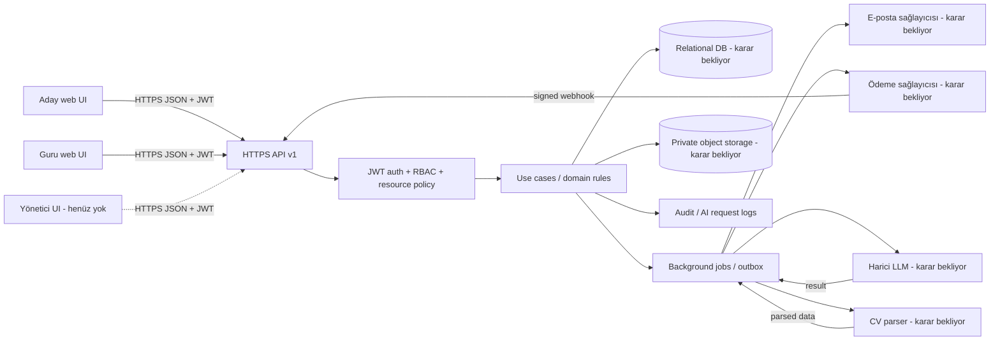

# Interview Demo — Backend Mimari Önerisi

## 1. Kapsam ve karar durumu

Mevcut proje düz HTML/CSS/JavaScript demosudur; çalışan backend, API, seçilmiş framework/DBMS/hosting veya production entegrasyonu bulunmuyor. Bu belge, istenen endpoint/veri ihtiyaçları için teknolojiye kilitlenmeyen katman ve dağıtım önerisidir.

API_SPEC.md'deki uçlar öneridir. DATA_MODEL.md şu anda backend entity/migration olmadığını bildirir; aşağıdaki katman ve klasörlerde anılan entity, repository ve migration'lar uygulanmış model değil, olası sorumluluk sınırlarıdır.

- Ürün: adayların Guru ile kariyer hikâyesi hazırladığı kariyer koçluğu platformu.
- Hedef roller: Danışan (Aday), Guru (Danışman), Yönetici. Mevcut demo session kodu yalnızca `danisan` ve `danisman` rollerini kullanır; yönetici paneli yoktur.
- Raporun backend, veritabanı, file store, LLM ve ödeme sağlayıcısı seçimleri açık karardır.

## 2. Katmanlı mimari

**VARSAYIM:** Pilot başlangıcı için modüler monolit (tek backend dağıtımı, modüller arası belirgin sınır) mikroservislerden daha basit işletilir. Hacim, ekip ve ölçek gereksinimleri doğrulanmadan mikroservis ayrımı önerilmez.

1. **Presentation / API layer** — HTTP route'ları, request parsing/schema validation, response serialization, OpenAPI sözleşmesi ve error mapping. UI/HTTP ayrıntıları domain kurallarından ayrı tutulur.
2. **Application layer** — use case/service işlemleri ve transaction sınırları: register, consent, payment, booking, story save/generate, note share, assignment submit.
3. **Domain layer** — entity, value object, enum, durum makinesi ve iş kuralları. Örnek: reservation çakışma koruması, `StorySession` geçiş guard'ları, en çok iki ardışık follow-up, rıza kontrolü.
4. **Infrastructure layer** — DB repository/adapters, password hasher/token signing, file storage, email sender, payment provider, LLM, CV parser, clock/queue.
5. **Cross-cutting** — config/secrets, structured logs/request ID, audit, telemetry, rate limit, health checks, migration ve feature flags.

Dependency yönü: API → application → domain; application port/interface'leri tanımlar, infrastructure bunları uygular. Domain dış servis veya HTTP tiplerini import etmez. Dış ödeme/LLM/storage çağrıları adapter arayüzleri arkasında kalır.

## 3. Klasör yapısı önerisi

**VARSAYIM:** Aşağıdaki `src/` ve TypeScript benzeri modül isimleri örnek organizasyondur; Node.js/NestJS ya da başka runtime seçildiği anlamına gelmez. Seçilecek dil/framework'e çevrilmelidir.

```text
backend/
  src/
    bootstrap/             # app start, HTTP server, lifecycle
    config/                # env parsing, typed settings, validation
    api/
      v1/
        routes/            # HTTP route registration/controllers
        middleware/        # auth, requestId, rate limit, error boundary
        schemas/           # request/response schema definitions
        serializers/       # wire-format (UI-compatible field names)
    modules/
      identity/            # users, verification, JWT/session, roles
      catalog/             # Guru, services, prices
      enrollment/          # purchase lifecycle, consent, payment
      candidate-profile/   # dynamic form and TargetContext
      cv/                  # upload, parse, approval, deletion request
      scheduling/          # Guru availability, appointment, session
      story/               # questions, answers, follow-ups, drafts, outputs
      guru-workspace/      # notes, candidate access, assignments, submissions
      admin/               # management APIs; UI currently absent
      audit/               # append-only audit events
      notifications/       # email notification records/dispatch
    domain/                # shared domain primitives and policies only
    infrastructure/
      persistence/         # DB client, migrations, repositories
      auth/                # password hash, JWT signer/verifier
      storage/             # private object storage adapter
      email/               # provider adapter
      payments/            # provider adapter + webhook verification
      ai/                  # LLM adapter, timeout/retry, provider redaction
      cv-parser/            # parser adapter
      jobs/                # outbox/background workers
    observability/         # structured logger, metrics, tracing
  migrations/
  tests/
    unit/
    integration/
    contract/
    e2e/
  .env.example             # names and safe placeholders only; no secrets
```

Modül içlerinde önerilen akış `route/controller → application use case → repository/provider port → adapter`. Ortak domain modeli ile UI mock serializer ayrı tutulur; storage entity'si doğrudan public JSON olarak expose edilmez.

## 4. Kimlik doğrulama ve yetkilendirme

Kullanıcı özellikle JWT yaklaşımı talep etti. Aşağıdaki uygulama **VARSAYIM/öneri**dir; gereksinim raporundaki auth ifadesi `******` olarak maskelidir ve proje tarafından onaylanmış auth teknolojisi olarak yorumlanmamalıdır.

### Önerilen akış

- Login/e-posta doğrulama başarılı olduğunda kısa ömürlü imzalı access JWT üret; `sub`, `role`, `iat`, `exp`, `jti` claim'lerini taşı.
- Yenileme/iptal edilebilir oturum için opaque refresh token veya token-family kaydı kullan; yalnızca hash'ini DB'de sakla. Logout, parola değişikliği, hesap pasifleştirme ve rol değişikliği sonrası iptal et.
- Web istemcisinde tercihen `Secure`, `HttpOnly`, uygun `SameSite` cookie kullan; CSRF önlemini cookie stratejisine göre uygula. Bearer header istemcisi seçilirse XSS riskine karşı token saklama kararı tehdit modelinde belgelenmelidir.
- `role` değerlerini UI ile uyumlu `danisan`, `danisman`, `yonetici` olarak wire contract'ta sabitle. DB enum'u başka adlandırılsa bile API serializer mapping yapar.
- Access kontrolü iki aşamalıdır: role permission + resource relationship. Örnek: Guru `danisman` olsa da yalnızca kendisine atanmış adayın kaydına erişebilir; CV/ham cevap için geçerli aday rızası ayrıca gerekir.
- Her endpoint default deny; object ID bilmek tek başına erişim sağlamaz. List endpoints repository query'lerinde actor scope uygular; sonradan response filtrelemek yeterli değildir.
- Admin actions ayrı permission/policy testleriyle sınırlandırılır. MFA, admin alt roller, token süreleri ve concurrent device limitleri açık sorudur.

`file://` protokolünde üretim cookie/CORS/origin güvenlik varsayımları sağlanamaz. Backend'e bağlanacak frontend HTTPS üzerinde tanımlı bir origin'de çalışmalıdır. Mevcut demo file:// uyumluluğu API güvenlik gereksinimini değiştirmez.

## 5. Dosya yükleme ve kişisel veri

Dosyalar CV, harici hikâye ve ödev teslimlerini kapsar. Rapor PDF/DOCX ve 10 MB değerlerini **öneri** olarak verir; nihai limit/uzantı onayı yoktur. Demo `hikaye-yukle.html` `.txt/.md` metin seçimini; `odev-teslim.html` PDF/DOCX kabul görünümünü içerir.

**VARSAYIM:** Private object storage'a kısa ömürlü imzalı upload/download URL, DB'de yalnızca metadata ve object key. Alternatif multipart proxy, runtime/hosting kararıdır.

1. Aday/Guru, yetki ve enrollment kontrolünden sonra upload intent ve dosya metadata'sı alır.
2. API uzantı, bildirilen MIME ve boyutu allowlist/limit ile doğrular; tek başına client MIME'ına güvenmez.
3. Dosya storage'a private yüklenir; tamamlanma callback'i veya server verification sonrası parse/scan job'u kuyruğa alınır.
4. CV parsing sonucu `parsedData` olarak adayın incelemesine sunulur; `candidateApprovedAt` oluşmadan story generator'a kaynak yapılmaz.
5. Guru CV/ham cevabı yalnızca geçerli rıza ve aday atama ilişkisi varsa okuyabilir. Dosya URL'si public veya tahmin edilebilir olmamalıdır.
6. Silme isteği storage delete + DB/audit/retention akışıyla koordine edilir; yedek/saklama istisnaları hukuk kararı gerektirir.

## 6. E-posta, bildirim ve harici servisler

Rapor e-posta doğrulaması ve not/ödev/hikâye bildirimi bekler. Gerçek provider seçilmemiştir.

| Port / adapter | Sorumluluk | Durum |
|---|---|---|
| `EmailSender` | OTP/verification, davet, reset, not/ödev bildirimi | Gereksinim/akış var, sağlayıcı ve kesin SLA seçilmemiş. |
| `PaymentProvider` | checkout başlatma, webhook doğrulama, ödeme/refund durum sorgusu | Üçüncü taraf gerekli, sağlayıcı seçilmemiş. Kart bilgisi uygulamaya girmemeli. |
| `ObjectStorage` | CV/story/submission dosyaları | Gereksinim var, provider/region seçilmemiş. |
| `CVParser` | CV içeriğini parse etme ve yapılandırılmış alanları döndürme | Rapor hedefi, araç seçilmemiş. |
| `StoryAIProvider` | soru/takip/hikâye/çıktı üretimi | Harici LLM gerekli; provider/model/veri konumu/eğitim kullanımı seçilmemiş. |
| `Calendar/MeetingProvider` | müsaitlik/appointment ve olası meeting link'i | UI'da demo var; canlı görüşme altyapısı açık soru. |

**VARSAYIM:** Yavaş/başarısız parse, e-posta, payment query ve AI generation arka plan job'u/outbox ile retry edilir. Retry idempotent olmalı; ödeme ve dosya işlemleri yeniden çalıştırılırken çift kayıt/çift tahsilat üretmemelidir. AI timeout sırasında aday cevabı zaten kalıcı kaydedilmiş olmalıdır.

LLM'e gerçek aday verisi göndermeden önce veri lokasyonu, eğitimde kullanım, retention, aktarım ve hukuki temel doğrulanmalıdır. AI prompt/response içeriği loglara varsayılan olarak yazılmamalıdır; rapor minimum olarak model/tür/token/maliyet/süre loglar.

## 7. Ortam değişkenleri

Sadece değişken adları/yer tutucular listelenmiştir; secret değeri eklenmemelidir. Gerçek env doğrulaması başlangıçta yapılmalı; gerekli production secret eksikse uygulama güvenli biçimde başlamamalıdır.

| Değişken | Amaç | Durum |
|---|---|---|
| `APP_ENV` | local/test/staging/production | Öneri |
| `APP_PORT` | HTTP portu | Runtime'a bağlı |
| `PUBLIC_BASE_URL` | E-posta callback/link ve provider redirect origin | Hosting kararı gerekli |
| `CORS_ALLOWED_ORIGINS` | Açıkça izinli frontend origin listesi | `file://` production origin değildir |
| `DATABASE_URL` | DB bağlantısı | DB seçimi açık |
| `DATABASE_POOL_MAX` | Bağlantı havuzu | Performans ayarı |
| `JWT_ISSUER`, `JWT_AUDIENCE` | JWT claim doğrulaması | Öneri |
| `JWT_PRIVATE_KEY` / `JWT_SIGNING_KEY` | İmzalama key'i veya key-provider referansı | Secret manager kullan; değeri `.env.example` içine koyma |
| `ACCESS_TOKEN_TTL_SECONDS` | Access JWT ömrü | Paydaş kararı gerekir |
| `REFRESH_TOKEN_TTL_SECONDS` | Refresh oturum süresi | Paydaş kararı gerekir |
| `PASSWORD_HASH_COST` | Seçilen password hasher parametresi | Algoritma ve parametre güvenlik incelemesiyle seçilmeli |
| `EMAIL_PROVIDER`, `EMAIL_API_KEY`, `EMAIL_FROM` | E-posta adapter ayarları | Provider seçilmemiş |
| `PAYMENT_PROVIDER`, `PAYMENT_API_KEY`, `PAYMENT_WEBHOOK_SECRET` | Checkout/webhook | Provider seçilmemiş; secret manager |
| `STORAGE_PROVIDER`, `STORAGE_BUCKET`, `STORAGE_REGION`, `STORAGE_ACCESS_KEY`, `STORAGE_SECRET_KEY` | Private dosya depolama | Provider/region seçilmemiş |
| `UPLOAD_MAX_BYTES`, `UPLOAD_ALLOWED_MIME_TYPES` | Upload sınırı | İş kararı gerekli; öneri 10 MiB PDF/DOCX CV |
| `AI_PROVIDER`, `AI_MODEL`, `AI_API_KEY`, `AI_TIMEOUT_MS`, `AI_MAX_RETRIES` | LLM adapter | Provider/model kararına bağlı |
| `CV_PARSER_PROVIDER`, `CV_PARSER_API_KEY` | CV parsing adapter | Parser kararı açık |
| `LOG_LEVEL`, `LOG_REDACT_FIELDS` | Yapılandırılmış log ve PII redaction | Öneri |
| `OTEL_EXPORTER_OTLP_ENDPOINT` | Telemetry export | Opsiyonel, observability kararı |
| `RATE_LIMIT_*` | Auth/upload/AI endpoint limitleri | Kapasite ve abuse testleriyle ayarlanmalı |

## 8. Loglama, audit ve hata yönetimi

- JSON structured logs: `timestamp`, `level`, `service`, `environment`, `requestId`, `route`, `method`, `statusCode`, `durationMs`, `actorId` (varsa), `errorCode`.
- E-posta, token, parola, CV/story/answer/note metni, payment secret ve provider raw body loglanmamalıdır. `LOG_REDACT_FIELDS` allowlist/denylist ile test edilir.
- `requestId` middleware her istek için bir correlation ID üretir; hata response ve downstream loglarda aynı ID kullanılır.
- Domain/business hataları kontrollü error code'lara çevrilir; beklenmeyen exception'lar `500 INTERNAL_ERROR` olur. Stack trace yalnızca yetkili server logs'a, redaction ile gider.
- Audit log iş olayıdır; uygulama logunun yerine geçmez. Giriş, rıza, ödeme/webhook, CV upload/approval/delete, hikâye üretim/sürümleme, note share, assignment, appointment ve admin config değişiklikleri append-only event olarak kaydedilir.
- AIRequestLogs kişisel metin yerine istek türü, model, token, maliyet, süre ve sonuç metadata'sı tutar; ham prompt/response kaydı ayrı hukuk ve retention onayı olmadan kapalıdır.
- Health endpoints: readiness DB/required config kontrol eder; liveness yalnızca process health. Public health response secret/stack bilgisi açmaz.
- Alert/metrics: payment webhook failure/lag, AI timeout/cost, queue age, upload/parse failure ve 5xx trendi. SLA hedefleri raporda öneri olduğundan pilot ölçümüyle doğrulanmalıdır.

## 9. Test stratejisi

1. **Unit/domain:** rol/resource policy; booking precondition; overlap; ödeme state transition/idempotency; story state machine; en çok iki ardışık follow-up; source provenance; CV approval gate.
2. **API contract:** `API_SPEC.md` request/response alan adları, enum ve error formatı; OpenAPI/schema validation; `demoSecim`, slot, appointment, `guruProfile`, task ve story payload compatibility tests.
3. **Integration:** gerçek test DB migration/repository, object-storage emulator/sandbox, email mock, payment sandbox/webhook signature, LLM/CV parser stub ve retry/timeout.
4. **Authorization/security:** adaylar birbirinin kaydına erişemez; Guru yalnızca atanmış adaya ve geçerli rıza kapsamına erişir; admin permission ayrımı; dosya signed URL süresi ve erişim kontrolü; IDOR/CSRF/rate-limit testleri.
5. **End-to-end:** kayıt → e-posta doğrulama → hizmet/Guru → ödeme → profil/consent/CV onayı → rezervasyon → ilk seans → soru/cevap → story outputs → Guru note/assignment → aday submission → ikinci seans.
6. **Resilience:** AI/e-posta/storage/payment timeout, duplicate webhook, failed retry, queue restart, slot contention ve partial file upload.
7. **Privacy/operations:** log redaction, audit completeness, data export/delete, backup restore, retention task.

Mevcut statik UI için contract testi tarayıcıda görülen demo JSON fixture'larıyla yapılabilir; production backend'e bağlanma, gerçek E2E kabul adımı olarak ayrıca tanımlanmalıdır.

## 10. Sistem diyagramı



## 11. Açık kararlar

- Runtime/framework, database, hosting, file store, queue, e-mail, payment, LLM ve CV parser sağlayıcıları.
- JWT issuer/signing key rotasyonu, access/refresh TTL, browser cookie/header stratejisi ve admin MFA.
- DB'nin ilişkisel model/JSON desteği ve migration/backup/restore planı.
- CV/story/submission dosya tipleri, kesin boyut sınırları, malware scan, data region ve retention.
- Payment sandbox/0-TL pilot akışı, webhook imzası, refund ve idempotency sözleşmesi.
- LLM prompt/response logging sınırı, model veriyi eğitir mi, yurt dışı aktarımı ve KVKK hukuk onayı.
- Appointment timezone/no-show/cancellation, meeting provider ve meeting URL saklama politikası.
- Admin paneli ve alt yetki matrisi; mevcut UI'da ekran yok.

## 12. İlgili belgeler

- [API sözleşmesi](./API_SPEC.md)
- [PRD](./PRD.md)
- [Sayfa haritası](./PAGES_MAP.md)
- [Veri modeli](./DATA_MODEL.md)
- [Backend uygulama planı](./BACKEND-IMPLEMENTATION-PLAN.md)
